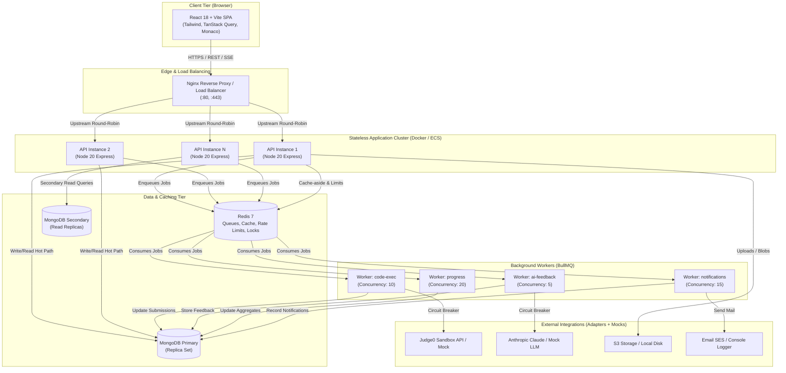
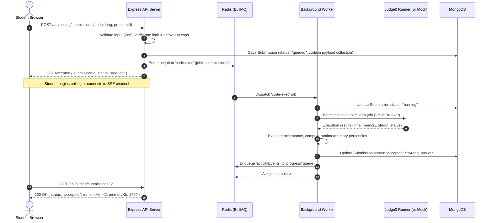
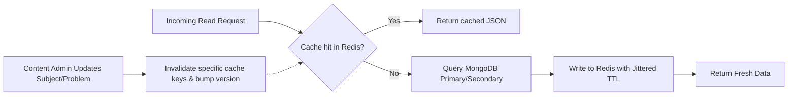
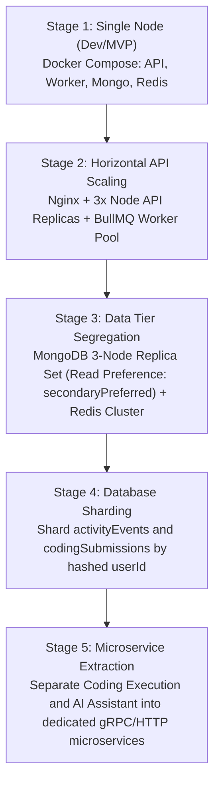

# EngineerOS — System Architecture & Design Document

## 1. Executive Summary

**EngineerOS** is a unified, production-grade operating system designed for engineering students. It consolidates academics, DSA/competitive coding, GATE preparation, AI-powered contextual assistance, proctored assessments, senior-junior/alumni mentorship, and AI mock interviews into a single high-performance platform.

EngineerOS is designed as a **modular monolith** with clear domain separation, stateless HTTP API nodes, dedicated background worker processes, Redis caching/queues, and a replica-set MongoDB database layer. Every heavy or non-blocking operation (code execution, AI evaluations, progress aggregations, emails) is offloaded to BullMQ worker queues to ensure low p95 latency (< 100ms) on HTTP endpoints.

---

## 2. High-Level System Architecture

The architecture consists of three tiers with decoupled external integrations:

1. **Client Tier**: Single Page Application built on React 18, Vite, Tailwind CSS, TanStack Query, and Monaco Editor. Communicates with backend via RESTful JSON APIs and Server-Sent Events (SSE) for streaming AI tokens and real-time execution updates.
2. **Gateway & Load Balancing Tier**: Nginx reverse proxy providing TLS termination, HTTP/2 multiplexing, static asset caching, request routing, and round-robin load balancing across horizontal API nodes.
3. **Application Tier (Modular Monolith)**:
   - **`api` process (Stateless Express)**: Handles authentication, validation, authorization (RBAC), synchronous reads, cache queries, and enqueuing of long-running operations.
   - **`worker` process (BullMQ Consumers)**: Consumes from dedicated queues (`code-exec`, `ai-feedback`, `progress`, `notifications`) with configurable concurrency, rate limits, and dead-letter queues (DLQ).
4. **Data & State Tier**:
   - **MongoDB Replica Set**: Primary transactional document store with secondary reads for analytics, compound indexes for every hot path, cursor pagination, and time-to-live (TTL) expiration on audit/activity streams.
   - **Redis**: Distributed in-memory data store used for BullMQ job queues, tiered rate-limiting tokens, cache-aside data (catalogues, leaderboards, user dashboard summaries), and distributed locks.
5. **Integration Tier (Adapters with Circuit Breakers)**:
   - **Code Execution**: Judge0 CE/PE API adapter with local mock fallback for zero-dependency local development and sandboxed container safety.
   - **LLM Provider**: Anthropic Claude API / OpenAI adapter with local mock fallback, streaming SSE integration, and strict JSON rubric validation.
   - **Object Storage**: S3-compatible adapter with local filesystem fallback for large blobs (code payloads, test cases, resumes).
   - **Email Provider**: SMTP/SES adapter with local console mock fallback.



---

## 3. Modular Monolith Architecture & Module Boundaries

To prevent coupling and enable effortless extraction into microservices if needed, the API strictly enforces domain boundaries:

- **Presentation Layer**: Express routers and request-handling controllers. Validates input using Zod schemas and normalizes parameters.
- **Application Layer**: Module services encapsulating domain business logic. Modules **never import other modules' Mongoose models directly**; cross-domain communication occurs strictly through public service interfaces or asynchronous domain events (`activityEvents`).
- **Data Access Layer**: Repositories wrapping Mongoose models to isolate queries, projections, indexes, and database transactions.

### Domain Modules:

1. `auth`: Token lifecycle, argon2id hashing, rotating refresh tokens, session revocation, brute-force protection.
2. `users`: Profiles, university/branch/semester settings, student/senior/alumni tags, goals.
3. `dashboard`: "What should I do today?" deterministic recommendation engine, reading exclusively from pre-aggregated progress data.
4. `academics`: University -> Branch -> Semester -> Subject -> Topic syllabus tree, PYQs, lecture notes, student completion tracking.
5. `coding`: Problem catalogue, hidden test case management, submission queuing, Monaco configuration, contests, Redis leaderboard sorted sets.
6. `gate`: Syllabus breakdown, question bank, timed mock tests with strict MCQ/MSQ/NAT negative marking scoring engine, attempt reviews.
7. `ai-assistant`: Contextual grounded chat over academic/GATE content using text retrieval, streaming SSE responses, token budget caps, circuit breaker.
8. `assessments`: Scheduled/live assessment engine, server-authoritative timer, autosave, resumption, consent verification, integrity monitoring review signals.
9. `community`: Threads, separate replies collection, tags, upvotes, accepted answers, moderation queue, anti-spam heuristics.
10. `interviews`: AI mock interview session manager, multi-question prompt chains, asynchronous rubric-based grading via LLM queue.
11. `progress`: Central event aggregator consuming `activityEvents` and updating `progressSummaries` idempotently.
12. `notifications`: In-app feed and email notifications.
13. `admin`: Role-based governance, content approval workflow, flag reviews, platform configuration, audit logging.

---

## 4. Asynchronous Queue Processing & BullMQ Topology

External API calls (code sandboxes, AI generation) and high-throughput aggregations are decoupled from the HTTP cycle via BullMQ queues backed by Redis:



### Queue Configuration & Policies:

- **`code-exec`**: Concurrency 10, timeout 30s, max 2 retries with exponential backoff (1s, 2s). Idempotency key = `submissionId`.
- **`ai-feedback`**: Concurrency 5, timeout 60s, max 3 retries with jittered backoff. Circuit breaker opens after 5 consecutive failures.
- **`progress`**: Concurrency 20, batch size 50, ensures idempotent upsert on `progressSummaries`.
- **`notifications`**: Concurrency 15, rate limited to comply with external email quotas.

---

## 5. Caching Strategy & Redis Topology

A cache-aside pattern is applied to read-heavy, low-churn resources to minimize database overhead:



1. **Academic Syllabus & Resources**: Cached under `cache:academics:subjects:{id}` and `cache:academics:list:{filterHash}`. Versioned tags ensure batch invalidation when admins publish updates. TTL: 24 hours.
2. **Coding Problem Statements & Samples**: Cached under `cache:coding:problem:{slug}`. Hidden test cases are never cached in Redis or exposed to API responses. TTL: 12 hours.
3. **User Dashboard Summary**: Cached under `cache:dashboard:summary:{userId}`. Invalidation triggered on progress worker completion. Short TTL: 5 minutes with single-flight locking to avoid cache stampede.
4. **Contest Leaderboards**: Maintained directly in Redis Sorted Sets (`zset:contest:{contestId}:scores`), enabling instant O(log N) rank and percentile queries.

---

## 6. Comprehensive Entity-Relationship Diagram (ERD)

```mermaid
erDiagram
    users ||--o{ refreshTokens : owns
    users ||--o{ codingSubmissions : submits
    users ||--o{ gateAttempts : takes
    users ||--o{ assessmentAttempts : attempts
    users ||--o{ communityPosts : authors
    users ||--o{ communityReplies : writes
    users ||--o{ interviewSessions : initiates
    users ||--o{ activityEvents : generates
    users ||--|| progressSummaries : has
    users ||--o{ notifications : receives

    subjects ||--o{ academicResources : contains
    codingProblems ||--o{ codingTestCases : has
    codingProblems ||--o{ codingSubmissions : receives
    codingSubmissions ||--|| submissionPayloads : stores

    gateTests ||--o{ gateAttempts : tracks
    questionBank ||--o{ assessments : configures
    assessments ||--o{ assessmentAttempts : governs
    assessmentAttempts ||--o{ monitoringEvents : records

    communityPosts ||--o{ communityReplies : has
    communityPosts ||--o{ reports : triggers

    interviewSessions ||--|| aiConversations : records

    users {
        ObjectId _id PK
        string email UK
        string passwordHash
        string role "student|senior|contentAdmin|platformAdmin"
        boolean isAlumni
        string university
        string branch
        int semester
        object profile
        timestamp createdAt
    }

    codingProblems {
        ObjectId _id PK
        string slug UK
        string title
        string difficulty "easy|medium|hard"
        string[] tags
        string statementMarkdown
        object constraints
        json sampleTestCases
        timestamp createdAt
    }

    codingSubmissions {
        ObjectId _id PK
        ObjectId problemId FK
        ObjectId userId FK
        string language "cpp|java|python|javascript"
        string status "queued|running|accepted|wrong_answer|tle|runtime_error|compile_error"
        int runtimeMs
        int memoryKb
        int testCasesPassed
        int totalTestCases
        ObjectId payloadId FK
        timestamp submittedAt
    }

    submissionPayloads {
        ObjectId _id PK
        string sourceCode
        string compileError
        json executionTrace
    }

    assessments {
        ObjectId _id PK
        string title
        int durationMinutes
        timestamp windowStart
        timestamp windowEnd
        string status "draft|scheduled|live|closed"
        json ruleConfig
        ObjectId[] questionIds FK
    }

    assessmentAttempts {
        ObjectId _id PK
        ObjectId assessmentId FK
        ObjectId userId FK
        string status "in_progress|submitted|expired|flagged"
        timestamp startedAt
        timestamp expiresAt
        timestamp submittedAt
        int score
        json answers
    }

    monitoringEvents {
        ObjectId _id PK
        ObjectId attemptId FK
        ObjectId userId FK
        string eventType "tab_hidden|window_blur|fullscreen_exit|paste_attempt"
        json metadata
        timestamp occurredAt
    }

    activityEvents {
        ObjectId _id PK
        ObjectId userId FK
        string module "academics|coding|gate|assessments|interviews"
        string action
        json payload
        timestamp occurredAt
    }

    progressSummaries {
        ObjectId _id PK
        ObjectId userId FK UK
        object academicsStats
        object codingStats
        object gateStats
        object assessmentStats
        object interviewStats
        timestamp updatedAt
    }
```

---

## 7. Capacity Estimation & Scalability Plan

### 7.1 Baseline Assumptions (100,000 Registered Users)

- **Active User Base**: 100,000 registered engineering students.
- **Daily Active Users (DAU)**: ~30,000 students (30% DAU/MAU).
- **Peak Concurrent Users (PCU)**: 10,000 concurrent students during evening peak hours (7:00 PM – 11:00 PM) or during live campus assessment windows.
- **Traffic Profile at Peak**:
  - Dashboard & Catalogue Reads: ~3,000 requests/second.
  - Active Code Submissions: 25 submissions/second peak (burst up to 50/sec during tests).
  - Assessment Heartbeats/Autosaves: 250 requests/second (10k students autosaving every 40s).
  - AI Assistant / Interview Interactions: 20 concurrent streaming sessions.

### 7.2 Storage Growth Estimates

| Data Category         | Avg Record Size  | Daily Ingestion           | Annual Volume | Retention Strategy                                                                |
| --------------------- | ---------------- | ------------------------- | ------------- | --------------------------------------------------------------------------------- |
| `activityEvents`      | 350 B            | 600,000 records (~210 MB) | ~76.6 GB      | 90-day retention via MongoDB TTL index. Aggregates stored in `progressSummaries`. |
| `codingSubmissions`   | 400 B (metadata) | 50,000 records (~20 MB)   | ~7.3 GB       | Retained indefinitely; compound index on `{userId, submittedAt: -1}`.             |
| `submissionPayloads`  | 4 KB             | 50,000 records (~200 MB)  | ~73 GB        | Moved to cold S3 object storage after 180 days.                                   |
| `monitoringEvents`    | 250 B            | 200,000 records (~50 MB)  | ~18.2 GB      | 60-day TTL index; purged automatically post-grading review.                       |
| Core Catalogs & Users | 2 KB             | Incremental               | < 5 GB        | Cached in Redis; retained in hot MongoDB replica set.                             |

### 7.3 Latency Targets (SLA)

- **Dashboard / Read Endpoints (p95)**: < 60ms (with Redis cache-aside) / < 120ms (cache-miss).
- **Code Submission Enqueue (p95)**: < 40ms (202 Accepted).
- **End-to-End Code Evaluation**: < 4.0s (under nominal queue load).
- **AI Streaming First Token (TTFT)**: < 800ms.

---

## 8. Staged Scaling Roadmap



1. **Stage 1 (Initial Launch)**: Containerized modular monolith. Single Express API node, single worker process, MongoDB, and Redis running in Docker.
2. **Stage 2 (Scale to 10k DAU)**: Scale API tier to 3-5 stateless instances behind an Nginx load balancer. Workers run in a distinct container pool scaled independently according to queue depths.
3. **Stage 3 (Scale to 50k DAU)**: Implement MongoDB replica set with `secondaryPreferred` read routing for read-only catalogues and search. Cluster Redis with sentinel/cluster mode.
4. **Stage 4 (Scale to 100k+ DAU)**: Shard write-heavy collections (`activityEvents`, `codingSubmissions`, `monitoringEvents`) by `{userId: "hashed"}` to distribute disk I/O.
5. **Stage 5 (Enterprise / Multi-Tenant)**: Extract the `coding` sandbox orchestration and `ai-assistant` streaming service into independent microservices with dedicated autoscaling pools.

---

## 9. Resilience, Fault Tolerance & Security Architecture

### 9.1 Circuit Breakers & Failover (Opossum)

- All external dependencies (Judge0 sandbox, Anthropic LLM, SES mailer) are wrapped in **Opossum circuit breakers**.
- Threshold: 50% failure rate over a 10-second rolling window opens the circuit.
- Fallback behavior: Immediate user-facing degradation notices ("Code evaluation runner is currently experiencing high load. Your submission is safely queued and will process shortly.") without thread starvation.

### 9.2 Security Blueprint

- **Password Hashing**: `argon2id` (memory: 64MB, iterations: 3, parallelism: 1) or `bcrypt` (cost: 12).
- **Authentication**: Short-lived JWT (15 minutes) + rotating cryptographically secure refresh token stored in `httpOnly`, `Secure`, `SameSite=Strict` cookies. Refresh token reuse triggers immediate family invalidation and session termination.
- **Rate Limiting**: Multi-tiered Redis token bucket:
  - Auth endpoints (`/api/auth/*`): 10 req/min per IP.
  - Submission endpoints (`/api/coding/submissions`): 15 req/min per user.
  - AI Assistant: 10 req/min per user + daily token quota.
  - Global API: 120 req/min per IP.
- **Input Sanitization & Injection Protection**: Strict Zod schema parsing on all requests. MongoDB query object validation prevents NoSQL operator injection (`$gt`, `$ne`). DOMPurify sanitizes Markdown content before HTML rendering.
- **Untrusted Code Security**: Student code is NEVER executed on the host server. Submissions are queued and dispatched to an isolated, sandboxed Judge0 runner with strict seccomp profiles, restricted network access, memory limits (256MB), and execution timeouts (3s).

---

## 10. Architectural Decision Records (ADRs) Summary

| ADR ID      | Decision                                                         | Status   | Rationale                                                                                                        |
| ----------- | ---------------------------------------------------------------- | -------- | ---------------------------------------------------------------------------------------------------------------- |
| **ADR-001** | Modular Monolith vs Microservices                                | Accepted | Avoids premature distributed systems overhead; enforces domain isolation via internal public service interfaces. |
| **ADR-002** | Separate API and Worker processes                                | Accepted | Prevents CPU-intensive tasks (code evaluation, AI parsing, aggregations) from degrading HTTP request latency.    |
| **ADR-003** | httpOnly Cookie-based Refresh Token Rotation                     | Accepted | Protects against XSS token exfiltration while ensuring seamless token rotation and instant breach revocation.    |
| **ADR-004** | BullMQ + Redis for Async Workflows                               | Accepted | High throughput, priority queues, delayed jobs for assessment timeouts, and native concurrency controls.         |
| **ADR-005** | Pre-aggregated Progress Summaries                                | Accepted | Eliminates expensive on-the-fly table scans of millions of `activityEvents` when rendering user dashboards.      |
| **ADR-006** | Server-Sent Events (SSE) over WebSockets for AI & Code Execution | Accepted | Unidirectional streaming over HTTP/2 eliminates WebSocket connection state overhead on horizontal API nodes.     |
| **ADR-007** | Strict Provider Adapters with Local Mocks                        | Accepted | Enables 100% test coverage and out-of-the-box local development with zero third-party API keys required.         |
| **ADR-012** | Sharp-Powered Avatar Pipeline with Magic-Byte Validation         | Accepted | Strips EXIF metadata, generates high-efficiency WebP variants (512x512 & 128x128), and verifies image magic bytes. |
| **ADR-013** | Multi-Tier Storage Abstraction (`IStorageAdapter`)                | Accepted | Safe local disk storage in development with path-traversal prevention, seamlessly swappable with S3/GCS.          |
| **ADR-014** | Pre-Aggregated Profile Snapshots, Daily Telemetry & Badges       | Accepted | Sub-5ms O(1) profile reads via `profileSnapshots`, timezone-aware `dailyActivities`, and idempotent badge engine. |
| **ADR-015** | Server-Side Privacy Filtering for Shareable Profiles             | Accepted | Deletes disabled sections server-side before serialization, protecting unshared metrics from DevTools leakage.   |
| **ADR-016** | Unlisted Secret Share Tokens & Instant Invalidation              | Accepted | Enables private recruiter sharing via secret `?token=` query param with one-click token rotation.                |
| **ADR-017** | Multi-Theme Profile Card & High-DPI Canvas Rasterization         | Accepted | 5 distinctive themes rendered via Tailwind; 2x PNG and clipboard image generation via `html-to-image`.            |
| **ADR-018** | Actionable Daily Task Engine & Dashboard Redesign                | Accepted | Transforms dashboard into daily practice launcher with completable/snoozable tasks feeding real-time streaks.    |
| **ADR-019** | Global Module Polish: Monaco Sandbox, Calculator & Command Pal   | Accepted | Upgrades coding editor to Monaco with autosave, adds official GATE calculator, and global `Ctrl+K` palette.       |
