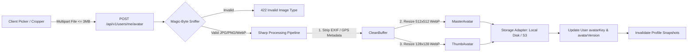

# EngineerOS — Phase 7 Architectural & UX Audit

> **Document Version:** 1.0.0  
> **Status:** Completed  
> **Date:** October 31, 2026  
> **Author:** Principal Full-Stack Engineer & Senior Product Designer  
> **Target:** Polish Every Module, Shareable Profile Card, Dashboard Redesign  

---

## 1. Executive Summary & Audit Methodology

Following the completion and verification of Phases 0 through 5, this audit establishes the baseline for **Phase 7: Comprehensive System Polish, Headline Profile Card Feature, and Central Dashboard Redesign**. 

While the system is functionally verified (44/44 backend tests passing, 0 lint errors, clean Vite production builds), the codebase currently exhibits typical "scaffold-stage" compromises:
1. **Frontend Styling Discrepancies**: Inconsistent styling paradigms across modules. Some pages utilize Tailwind design tokens, while key pages like [`ProblemSolvePage.jsx`](file:///C:/Users/Tusar/Desktop/Engineer_OS/client/src/features/coding/ProblemSolvePage.jsx) and [`GateTestPage.jsx`](file:///C:/Users/Tusar/Desktop/Engineer_OS/client/src/features/gate/GateTestPage.jsx) rely on inline CSS styles (`style={{ ... }}`), an unstyled HTML `<textarea>` instead of the installed Monaco editor, and mock fallback data hardcoded into `catch` blocks.
2. **Missing Interactive Depth**: Several critical user workflows are either purely modal-based (e.g., Academic topics) or lack live client state handling (e.g., client-only GATE timers, missing coding autosave, missing speech-to-text in interviews, lack of speech/audio options).
3. **Missing Headline Profile Card Infrastructure**: The student identity is currently represented as a bare text profile. The platform lacks avatar upload with magic-byte validation/sharp processing, unlisted public sharing, card themes, and PNG/PDF export pipelines.
4. **Dashboard Hardcoded Visuals**: The existing dashboard renders mock sparklines rather than real 12-month activity rollups, and lacks the ability to mark recommended daily tasks as completed or snoozed.

---

## 2. Module-by-Module In-Depth Audit

---

### 2.1 Auth, Users, Profile & Settings

#### (a) What Exists
- **Backend**:
  - [`User`](file:///C:/Users/Tusar/Desktop/Engineer_OS/server/src/modules/users/user.model.js) schema supporting Argon2id hashed passwords, RBAC (`student`, `senior`, `contentAdmin`, `platformAdmin`), `failedLoginAttempts`, `lockoutUntil`, and basic `profile` subdocument.
  - Endpoints: `POST /api/v1/auth/register`, `POST /api/v1/auth/login`, `POST /api/v1/auth/refresh`, `POST /api/v1/auth/logout`, `GET /api/v1/users/me`, `PATCH /api/v1/users/me`, `GET /api/v1/users/me/export`, `DELETE /api/v1/users/me`.
  - Token rotation with token family revocation upon reuse detection.
- **Frontend**:
  - Basic centered forms: [`LoginPage.jsx`](file:///C:/Users/Tusar/Desktop/Engineer_OS/client/src/features/auth/LoginPage.jsx), [`RegisterPage.jsx`](file:///C:/Users/Tusar/Desktop/Engineer_OS/client/src/features/auth/RegisterPage.jsx).
  - Basic account form: [`ProfilePage.jsx`](file:///C:/Users/Tusar/Desktop/Engineer_OS/client/src/features/profile/ProfilePage.jsx) with bio, university, branch, semester, and JSON export button.

#### (b) Bugs, Gaps & Weak UX
- **No Avatar Pipeline**: Avatar is currently a plain text URL string (`avatarUrl`). No multipart file upload, no drag-and-drop picker, no cropping tool, and no file validation.
- **Missing Onboarding Wizard**: First-time login drops students directly into a blank dashboard without guiding them to configure university, branch, semester, target goals, timezone, avatar, or unique username.
- **Missing Auth Features**:
  - No password strength indicator or show/hide password toggle.
  - Reset password token store is an in-memory `Map()` in [`auth.service.js`](file:///C:/Users/Tusar/Desktop/Engineer_OS/server/src/modules/auth/auth.service.js), which is lost on server restarts.
  - No active session list or "log out other devices" capability.
  - No email verification banner or resend flow.
- **Missing Profile Settings**:
  - No unique handle/username (validated, reserved blocklist).
  - No privacy controls (private / unlisted link / public) or per-section visibility toggles.
  - No theme customizer or connected profile link manager.

#### (c) Backend Weaknesses
- **Missing Schema Attributes**: `username`, `headline`, `avatarKey`, `avatarVersion`, `timezone`, `graduationYear` are absent from [`user.model.js`](file:///C:/Users/Tusar/Desktop/Engineer_OS/server/src/modules/users/user.model.js).
- **Missing Image Processing Pipeline**: No Sharp integration, EXIF metadata stripping, or magic-byte MIME sniffing.
- **In-Memory State**: Reset tokens are non-persistent.

#### (d) Prioritized Fix List
1. **[P0]** Add `username` (unique index, reserved blocklist), `headline`, `avatarKey`, `avatarVersion`, `timezone`, and `profileSettings` to User model.
2. **[P0]** Implement `POST /api/v1/users/me/avatar` with `multer`, magic-byte sniffing (`image-type` / file signatures), EXIF stripping, Sharp 512x512 re-encoding, and 128x128 thumbnail generation.
3. **[P1]** Persist password reset tokens and implement `GET /api/v1/auth/sessions` and `POST /api/v1/auth/sessions/revoke-others`.
4. **[P1]** Build interactive Onboarding Wizard on first login.
5. **[P2]** Modernize login/register screens with split layout, password strength meter, and password visibility toggle.

---

### 2.2 Dashboard & Recommendation Engine

#### (a) What Exists
- **Backend**:
  - [`DashboardService.getSummary`](file:///C:/Users/Tusar/Desktop/Engineer_OS/server/src/modules/dashboard/dashboard.service.js): Single O(1) read from [`ProgressSummary`](file:///C:/Users/Tusar/Desktop/Engineer_OS/server/src/modules/progress/progressSummary.model.js) with Redis cache-aside (5m TTL).
  - [`RecommendationEngine`](file:///C:/Users/Tusar/Desktop/Engineer_OS/server/src/modules/dashboard/recommendation.service.js): Generates 3–5 deterministic, actionable tasks based on user goals, streaks, pending syllabus, and weak GATE areas.
- **Frontend**:
  - [`DashboardPage.jsx`](file:///C:/Users/Tusar/Desktop/Engineer_OS/client/src/features/dashboard/DashboardPage.jsx): Welcome hero, recommendations list, 4 summary metric cards, hardcoded mock sparkline trend, and recent activity log.

#### (b) Bugs, Gaps & Weak UX
- **Hardcoded Activity Chart**: The 7-day sparkline in [`DashboardPage.jsx`](file:///C:/Users/Tusar/Desktop/Engineer_OS/client/src/features/dashboard/DashboardPage.jsx#L38-L46) uses hardcoded static days (`Mon`, `Tue`, `Wed`) rather than genuine historical data.
- **Static Action Items**: Recommendations cannot be marked as completed, snoozed, or customized.
- **No Profile Card Hero**: The dashboard lacks the headline EngineerOS Profile Card hero summarizing the student's holistic performance.
- **Monolithic Page Load**: Single query for the whole page; if summary calculation fails or hangs, the entire dashboard errors out.
- **No Module Strip**: Missing compact summary tiles for each domain with live sparklines and quick links.

#### (c) Backend Weaknesses
- **Missing Endpoints**: Missing `GET /api/v1/dashboard/today` for granular task management and `GET /api/v1/dashboard/heatmap` for the 365-day activity rollup.
- **No Task State Persistence**: No `dashboardTasks` model to track completed or snoozed daily actions.

#### (d) Prioritized Fix List
1. **[P0]** Redesign Dashboard layout around the live EngineerOS Profile Card.
2. **[P0]** Implement `GET /api/v1/dashboard/heatmap` backed by compact `dailyActivity` rollups.
3. **[P1]** Implement `GET /api/v1/dashboard/today` and `PATCH /api/v1/dashboard/tasks/:id` for checking off or snoozing daily actions.
4. **[P1]** Build modular domain strip tiles (Academics, Coding, GATE, Assessments, Community, Interviews) with real trend indicators.
5. **[P2]** Decouple dashboard queries with independent TanStack Query keys and widget-level error boundaries.

---

### 2.3 Academic Hub

#### (a) What Exists
- **Backend**:
  - [`Subject`](file:///C:/Users/Tusar/Desktop/Engineer_OS/server/src/modules/academics/subject.model.js), [`AcademicResource`](file:///C:/Users/Tusar/Desktop/Engineer_OS/server/src/modules/academics/academicResource.model.js), [`AcademicProgress`](file:///C:/Users/Tusar/Desktop/Engineer_OS/server/src/modules/academics/academicProgress.model.js).
  - Endpoints for listing subjects, viewing subject details, fetching resources, and toggling topic completion.
  - Seed data with 58 subjects and 174 resources across 8 semesters and 3 engineering branches.
- **Frontend**:
  - [`AcademicsPage.jsx`](file:///C:/Users/Tusar/Desktop/Engineer_OS/client/src/features/academics/AcademicsPage.jsx) with branch selector, semester tabs, subject cards, and modal topic drawer.

#### (b) Bugs, Gaps & Weak UX
- **Modal-Trapped Content**: Clicking a subject opens a modal with tabs instead of a focused, breadcrumbed drill-down view (`University -> Branch -> Semester -> Subject -> Topics/Resources`).
- **No Resource Grouping**: Resources are rendered in a flat list without clear categorization (Notes, Video Lectures, PYQs, Quizzes, Syllabus).
- **Missing Persistence Features**: No bookmarking, no "continue where you left off", and no recently viewed tracking.
- **Progress Rings Missing**: Subject cards show plain badge percentages rather than visual progress rings.

#### (c) Backend Weaknesses
- **Lack of View Tracking**: No resource access metrics to recommend popular notes.
- **Missing Link Health Checks**: Video lecture URLs are not checked for dead links.

#### (d) Prioritized Fix List
1. **[P1]** Convert Academic Hub to full drill-down navigation with breadcrumbs and persistent topic checkboxes.
2. **[P1]** Categorize resources into distinct tabs (Lecture Notes, Question Papers, Video Courses, Quizzes) with SVG progress rings.
3. **[P2]** Add bookmarks and "recently viewed subjects" stored in local storage and user profile.

---

### 2.4 Coding Platform (DSA)

#### (a) What Exists
- **Backend**:
  - [`CodingProblem`](file:///C:/Users/Tusar/Desktop/Engineer_OS/server/src/modules/coding/codingProblem.model.js), [`CodingTestCase`](file:///C:/Users/Tusar/Desktop/Engineer_OS/server/src/modules/coding/codingTestCase.model.js), [`CodingSubmission`](file:///C:/Users/Tusar/Desktop/Engineer_OS/server/src/modules/coding/codingSubmission.model.js), [`SubmissionPayload`](file:///C:/Users/Tusar/Desktop/Engineer_OS/server/src/modules/coding/submissionPayload.model.js).
  - Queue-based execution with BullMQ `code-exec`, Judge0 integration with offline mock sandbox fallback.
  - Seeded with 26 algorithm challenges and test cases.
- **Frontend**:
  - [`CodingCataloguePage.jsx`](file:///C:/Users/Tusar/Desktop/Engineer_OS/client/src/features/coding/CodingCataloguePage.jsx) problem list with filters.
  - [`ProblemSolvePage.jsx`](file:///C:/Users/Tusar/Desktop/Engineer_OS/client/src/features/coding/ProblemSolvePage.jsx) split view with sample runner and submission polling.

#### (b) Bugs, Gaps & Weak UX
- **CRITICAL UI FLAW**: [`ProblemSolvePage.jsx`](file:///C:/Users/Tusar/Desktop/Engineer_OS/client/src/features/coding/ProblemSolvePage.jsx#L455) renders a plain HTML `<textarea>` with raw inline styles instead of the installed `@monaco-editor/react` package!
- **Extensive Inline CSS**: Both coding pages are dominated by inline `style={{ ... }}` blocks rather than Tailwind CSS tokens.
- **Missing Editor Capabilities**:
  - No code autosave to localStorage per problem slug.
  - No custom input test runner.
  - No language preference memory across problems.
  - No unlockable hints or editorial solution view.
- **Catalogue Gaps**: Missing status filter (Solved / Attempted / Todo), no "Daily Problem" banner, and no curated topic roadmaps (e.g., Blind 75 / Top 150 Interview Questions).

#### (c) Backend Weaknesses
- **Contest Leaderboards**: Leaderboards are computed via ad-hoc queries rather than Redis sorted sets (`zset:contest`).
- **Per-User Concurrency Caps**: Missing rate-limit checks on active concurrent submissions per student.

#### (d) Prioritized Fix List
1. **[P0]** Replace HTML `<textarea>` in `ProblemSolvePage.jsx` with full `@monaco-editor/react` integration, theme support, and autosave.
2. **[P0]** Refactor all inline styles to Tailwind CSS tokens matching the design system.
3. **[P1]** Add custom input execution tab and unlockable editorial/hints tab.
4. **[P1]** Add problem status filtering (Solved/Attempted/Unsolved) and "Daily Problem" challenge card.

---

### 2.5 GATE Preparation Hub

#### (a) What Exists
- **Backend**:
  - [`GateTest`](file:///C:/Users/Tusar/Desktop/Engineer_OS/server/src/modules/gate/gateTest.model.js) and [`GateAttempt`](file:///C:/Users/Tusar/Desktop/Engineer_OS/server/src/modules/gate/gateAttempt.model.js).
  - Scoring engine with strict negative marking rules for MCQ (1/3 or 2/3 penalty), MSQ (all correct, no partial), and NAT (numerical tolerance).
- **Frontend**:
  - [`GateCataloguePage.jsx`](file:///C:/Users/Tusar/Desktop/Engineer_OS/client/src/features/gate/GateCataloguePage.jsx), [`GateTestPage.jsx`](file:///C:/Users/Tusar/Desktop/Engineer_OS/client/src/features/gate/GateTestPage.jsx), [`GateResultPage.jsx`](file:///C:/Users/Tusar/Desktop/Engineer_OS/client/src/features/gate/GateResultPage.jsx).

#### (b) Bugs, Gaps & Weak UX
- **Client-Side Only Timer**: [`GateTestPage.jsx`](file:///C:/Users/Tusar/Desktop/Engineer_OS/client/src/features/gate/GateTestPage.jsx#L51) initializes timer purely from state (`setTimeRemaining((data.durationMinutes || 180) * 60)`). Refreshing the browser resets the clock!
- **No In-Exam Autosave**: Responses are only stored in local React state and sent at final submission. A page reload loses all unsubmitted selections.
- **Inline Styling**: Entire exam interface uses raw CSS inline styles.
- **Missing Examination Features**:
  - No virtual scientific calculator widget placeholder.
  - No subject-wise syllabus weighting breakdown.
  - No previous year question (PYQ) browser sorted by year (2015–2025).

#### (c) Backend Weaknesses
- **Server Authoritative Resumption**: `startAttempt` does not compute remaining seconds from database attempt start timestamp.
- **Unbounded Attempt History**: Attempts list lacks cursor pagination.

#### (d) Prioritized Fix List
1. **[P0]** Implement server-authoritative timer and periodic autosave (`PATCH /api/v1/gate/attempts/:id/autosave`).
2. **[P0]** Refactor exam room UI to Tailwind CSS with realistic question palette (Answered, Marked for Review, Unvisited).
3. **[P1]** Implement Virtual Calculator modal and Question Paper overview sheet.
4. **[P1]** Build PYQ browser by year/subject with instant answer reveal.

---

### 2.6 AI Academic Assistant

#### (a) What Exists
- **Backend**:
  - [`assistantConversation.model.js`](file:///C:/Users/Tusar/Desktop/Engineer_OS/server/src/modules/ai/assistantConversation.model.js), [`assistant.service.js`](file:///C:/Users/Tusar/Desktop/Engineer_OS/server/src/modules/ai/assistant.service.js).
  - SSE streaming endpoint with grounded retrieval over syllabus notes and Claude / offline mock adapter.
- **Frontend**:
  - [`AiAssistantPage.jsx`](file:///C:/Users/Tusar/Desktop/Engineer_OS/client/src/features/ai-assistant/AiAssistantPage.jsx) with sidebar conversation history and streaming message thread.

#### (b) Bugs, Gaps & Weak UX
- **State Closure Bug**: In [`AiAssistantPage.jsx`](file:///C:/Users/Tusar/Desktop/Engineer_OS/client/src/features/ai-assistant/AiAssistantPage.jsx#L97), `streamingText` inside `onDone` callback captures an empty string from the initial closure, causing the assistant message to render empty upon stream completion unless hot-reloaded.
- **Plain Text Rendering**: Renders raw text without Markdown, syntax-highlighted code blocks, or KaTeX mathematical formulas.
- **Missing Quick Actions**: No "Explain simpler", "Give practical example", or "Generate quiz question" chips.
- **Missing Controls**: No Stop Generating, Copy Code, or Regenerate buttons.

#### (c) Backend Weaknesses
- **Connection Abort Handling**: No listener on `req.on('close')` to abort upstream LLM calls when a student navigates away.
- **No SSE Heartbeat**: Long reasoning pauses can cause browser proxy timeouts without `: ping\n\n` keep-alive comments.

#### (d) Prioritized Fix List
1. **[P0]** Fix state closure bug using refs for streaming tokens.
2. **[P0]** Add Markdown formatting, code copy buttons, and KaTeX math rendering.
3. **[P1]** Implement SSE keep-alive heartbeat and disconnect cancellation in backend.
4. **[P1]** Add prompt recommendation chips ("Explain simpler", "Code example", "Quiz me").

---

### 2.7 AI Mock Interviews

#### (a) What Exists
- **Backend**:
  - [`interviewSession.model.js`](file:///C:/Users/Tusar/Desktop/Engineer_OS/server/src/modules/ai/interviewSession.model.js), [`interview.service.js`](file:///C:/Users/Tusar/Desktop/Engineer_OS/server/src/modules/ai/interview.service.js).
  - 4 interview modes (Technical, DSA, Project, HR), multi-turn prompts, BullMQ asynchronous evaluation against a 4-criterion rubric.
- **Frontend**:
  - [`InterviewHubPage.jsx`](file:///C:/Users/Tusar/Desktop/Engineer_OS/client/src/features/interviews/InterviewHubPage.jsx) session list.
  - [`InterviewSessionPage.jsx`](file:///C:/Users/Tusar/Desktop/Engineer_OS/client/src/features/interviews/InterviewSessionPage.jsx) interactive interview room and feedback report.

#### (b) Bugs, Gaps & Weak UX
- **Missing Speech Input**: Text-only answer input; no browser Speech-to-Text (Web Speech API) option for realistic vocal practice.
- **No Historical Readiness Trend**: The hub displays past sessions in a plain list without a readiness progression line chart.
- **Inline Styling**: Dominated by inline CSS and static modal layouts.

#### (c) Backend Weaknesses
- **No Token Budget Guard**: Sessions could theoretically be spammed without cooldown rate limits.

#### (d) Prioritized Fix List
1. **[P1]** Integrate Web Speech API speech-to-text toggle in the live interview room.
2. **[P1]** Add Readiness Score history line chart and rubric breakdown radar chart to Interview Hub.
3. **[P2]** Refactor session room to Tailwind CSS with audio waveform simulation.

---

### 2.8 Assessments (Proctored)

#### (a) What Exists
- **Backend**:
  - [`assessment.model.js`](file:///C:/Users/Tusar/Desktop/Engineer_OS/server/src/modules/assessments/assessment.model.js), [`assessmentAttempt.model.js`](file:///C:/Users/Tusar/Desktop/Engineer_OS/server/src/modules/assessments/assessmentAttempt.model.js), [`monitoringEvent.model.js`](file:///C:/Users/Tusar/Desktop/Engineer_OS/server/src/modules/assessments/monitoringEvent.model.js).
  - Server timer sync, autosave endpoint, consent recording, integrity event ingestion (tab switches, fullscreen exits, copy/paste), faculty review signals portal.
- **Frontend**:
  - [`AssessmentCataloguePage.jsx`](file:///C:/Users/Tusar/Desktop/Engineer_OS/client/src/features/assessments/AssessmentCataloguePage.jsx), [`AssessmentTakePage.jsx`](file:///C:/Users/Tusar/Desktop/Engineer_OS/client/src/features/assessments/AssessmentTakePage.jsx), [`AssessmentReviewPage.jsx`](file:///C:/Users/Tusar/Desktop/Engineer_OS/client/src/features/assessments/AssessmentReviewPage.jsx).

#### (b) Bugs, Gaps & Weak UX
- **No Assessment Creator**: Faculty / ContentAdmins have no UI to create new assessments from the question bank.
- **No CSV Export**: Faculty cannot export assessment scores and candidate attempts to CSV.
- **Wording Audit**: Ensure all monitoring events strictly say "flagged for review" and never "cheating detected".

#### (c) Backend Weaknesses
- **Monitoring Events Volume**: Missing batching endpoint (`POST /api/v1/assessments/:id/events/batch`) to avoid high HTTP request overhead during exams.

#### (d) Prioritized Fix List
1. **[P1]** Build Faculty Assessment Creator drawer with question bank selection and scheduled windows.
2. **[P1]** Add CSV export endpoint for assessment score sheets.
3. **[P2]** Implement event batching in client proctoring tracker.

---

### 2.9 Senior–Junior & Alumni Community Network

#### (a) What Exists
- **Backend**:
  - [`communityPost.model.js`](file:///C:/Users/Tusar/Desktop/Engineer_OS/server/src/modules/community/communityPost.model.js), [`communityReply.model.js`](file:///C:/Users/Tusar/Desktop/Engineer_OS/server/src/modules/community/communityReply.model.js).
  - Segregated replies collection, upvoting, solution acceptance, senior badges.
- **Frontend**:
  - [`CommunityForumPage.jsx`](file:///C:/Users/Tusar/Desktop/Engineer_OS/client/src/features/community/CommunityForumPage.jsx), [`PostDetailPage.jsx`](file:///C:/Users/Tusar/Desktop/Engineer_OS/client/src/features/community/PostDetailPage.jsx).

#### (b) Bugs, Gaps & Weak UX
- **Mock Fallback on Error**: Line 57 of [`CommunityForumPage.jsx`](file:///C:/Users/Tusar/Desktop/Engineer_OS/client/src/features/community/CommunityForumPage.jsx#L57) falls back to hardcoded dummy data on API failure instead of displaying an accessible `ErrorState`.
- **Missing Feed Tabs**: Feed only supports category dropdown; missing "Latest", "Top", "Unanswered", and "Following" tabs.
- **Missing Mentor Directory**: No senior/alumni directory where juniors can filter mentors by company (e.g. Google, Microsoft), branch, and graduation year to initiate targeted "Ask a Senior" questions.
- **Plain Text Composer**: The post creation modal lacks rich Markdown preview.

#### (c) Backend Weaknesses
- **Missing Full-Text Index**: Text search across post title and body needs compound indexing with category and tags.
- **Spam Heuristic Validation**: Missing rate-limiting on rapid consecutive posts.

#### (d) Prioritized Fix List
1. **[P1]** Build Mentor Directory tab with company filters, senior cards (reusing Profile Card component), and 1-click targeted questions.
2. **[P1]** Add Feed Tabs (Latest, Top Voted, Unanswered, Ask a Senior) and Markdown composer with live preview.
3. **[P2]** Replace hardcoded error mock data with standard `ErrorState`.

---

### 2.10 Notifications & Global Navigation

#### (a) What Exists
- **Backend**: [`notification.model.js`](file:///C:/Users/Tusar/Desktop/Engineer_OS/server/src/modules/notifications/notification.model.js), notification service, unread counter.
- **Frontend**: Notification dropdown bell in [`DashboardLayout.jsx`](file:///C:/Users/Tusar/Desktop/Engineer_OS/client/src/layouts/DashboardLayout.jsx).

#### (b) Bugs, Gaps & Weak UX
- **Missing Command Palette**: No global `Ctrl+K` / `Cmd+K` command palette for jumping instantly to problems, subjects, GATE mock tests, or actions.
- **No Mobile Bottom Bar**: On mobile viewports (< 768px), navigation is hidden behind a hamburger menu without a quick-access bottom navigation bar.
- **Notification Dropdown Clutter**: Notifications open in a raw popover without category grouping or notification preference toggles.

#### (c) Prioritized Fix List
1. **[P1]** Implement global Command Palette (`Ctrl+K` / `Cmd+K`) supporting instant navigation across modules, problems, and subjects.
2. **[P1]** Add mobile bottom navigation bar for quick smartphone access.
3. **[P2]** Upgrade notification popover to an accessible sliding Drawer with grouping.

---

### 2.11 Progress, Activity & Streak Pipeline

#### (a) What Exists
- **Backend**: [`ActivityEvent`](file:///C:/Users/Tusar/Desktop/Engineer_OS/server/src/modules/progress/activityEvent.model.js) (with 90-day TTL), [`ProgressSummary`](file:///C:/Users/Tusar/Desktop/Engineer_OS/server/src/modules/progress/progressSummary.model.js), [`progress.worker.js`](file:///C:/Users/Tusar/Desktop/Engineer_OS/server/src/jobs/workers/progress.worker.js).

#### (b) Bugs, Gaps & Weak UX
- **No Daily Activity Rollup Table**: Activity is stored either as raw events (90-day TTL) or lifetime aggregate numbers in `ProgressSummary`. There is no 365-day compact table for generating a GitHub/LeetCode-style heatmap!
- **Timezone-Agnostic Streaks**: Streaks are calculated using `Date.toISOString().slice(0, 10)` (UTC), causing incorrect streak resets for users in positive or negative timezones (e.g. UTC+5:30).
- **Missing Badge Engine**: Badges are not yet awarded automatically on deterministic milestones.

#### (c) Prioritized Fix List
1. **[P0]** Create `DailyActivity` model (`{ userId, date, counts: { coding, gate, academics, interviews, community } }`) with compound index `{ userId: 1, date: -1 }`.
2. **[P0]** Build deterministic Badge Catalogue and award engine in `progress.worker.js`.
3. **[P1]** Implement timezone-aware streak computation.

---

## 3. Inventory of Old Dashboard & Profile Usages

To ensure zero regressions when redesigning the Dashboard and Profile Card, here is the complete map of where they are referenced:

### 3.1 Frontend Usages
| File Path | Usages & References | Action Needed in Phase 7 |
| :--- | :--- | :--- |
| [`client/src/app/router.jsx`](file:///C:/Users/Tusar/Desktop/Engineer_OS/client/src/app/router.jsx) | Line 46 (`/ -> /dashboard`), Line 60 (`/dashboard -> DashboardPage`), Line 61 (`/profile -> ProfilePage`) | Add `/u/:username` public profile route; update `/profile` and `/dashboard` |
| [`client/src/layouts/DashboardLayout.jsx`](file:///C:/Users/Tusar/Desktop/Engineer_OS/client/src/layouts/DashboardLayout.jsx) | Lines 97 (`/dashboard`), Line 105 (`/profile`), User avatar / initials display | Embed mini Profile Card / Avatar trigger; link to `/profile` |
| [`client/src/features/dashboard/DashboardPage.jsx`](file:///C:/Users/Tusar/Desktop/Engineer_OS/client/src/features/dashboard/DashboardPage.jsx) | Entire file (old dashboard view) | Completely redesign around the new live Profile Card hero |
| [`client/src/features/profile/ProfilePage.jsx`](file:///C:/Users/Tusar/Desktop/Engineer_OS/client/src/features/profile/ProfilePage.jsx) | Entire file (old settings form) | Transform into Profile Card studio (Preview, Customization, Avatar Cropper, Export) |
| [`client/src/services/dashboard.service.js`](file:///C:/Users/Tusar/Desktop/Engineer_OS/client/src/services/dashboard.service.js) | `getSummary()` | Add `getTodayActions()`, `updateTaskStatus()`, `getHeatmap()` |
| [`client/src/services/user.service.js`](file:///C:/Users/Tusar/Desktop/Engineer_OS/client/src/services/user.service.js) | `getMe()`, `updateMe()`, `exportMe()`, `deleteMe()` | Add `uploadAvatar()`, `deleteAvatar()`, `getProfileSnapshots()` |
| [`client/src/features/auth/AuthContext.jsx`](file:///C:/Users/Tusar/Desktop/Engineer_OS/client/src/features/auth/AuthContext.jsx) | User session state and `updateUser()` | Ensure updated profile fields (`username`, `avatarKey`, `settings`) hydrate properly |

### 3.2 Backend Usages
| File Path | Usages & References | Action Needed in Phase 7 |
| :--- | :--- | :--- |
| [`server/src/app.js`](file:///C:/Users/Tusar/Desktop/Engineer_OS/server/src/app.js) | Lines 104, 106 (`/api/v1/users`, `/api/v1/dashboard`) | Mount new `/api/v1/profile` routes and avatar upload middleware |
| [`server/src/modules/dashboard/dashboard.service.js`](file:///C:/Users/Tusar/Desktop/Engineer_OS/server/src/modules/dashboard/dashboard.service.js) | Summary assembly, Redis caching | Keep backward-compatible; add heatmap aggregation and task endpoints |
| [`server/src/modules/users/user.service.js`](file:///C:/Users/Tusar/Desktop/Engineer_OS/server/src/modules/users/user.service.js) | Profile retrieval & mutation | Add avatar upload handler with Sharp, username validation |
| [`server/src/jobs/workers/progress.worker.js`](file:///C:/Users/Tusar/Desktop/Engineer_OS/server/src/jobs/workers/progress.worker.js) | Cache invalidation `cache:dashboard:summary:${userId}` | Invalidate card cache and update `DailyActivity` rollup |

---

## 4. Headline Feature Architectural Blueprint: EngineerOS Profile Card

### 4.1 Card Specification & Visual Architecture
The **EngineerOS Card** is a compact, high-density visual summary of an engineering student's achievements:
```
+-------------------------------------------------------------------------------+
|  [Avatar]  Tusar Goswami  (@tusarg)                      [Badge: SDE Candidate]|
|  Massachusetts Institute of Technology • Computer Science • Sem 4 • Class '26 |
|  "Mastering Distributed Systems & Algorithmic Foundations"                    |
+-------------------------------------------------------------------------------+
| [CODING ARENA]         | [GATE CS]              | [ACADEMIC PROGRESS]        |
| 142 Solved (80E/50M/12H)| 72.4% Accuracy         | 68% Sem 4 Syllabus Done    |
| 78.5% Acceptance Rate  | 4 Mock Tests Completed | 4/5 Core Subjects In-Prog  |
| 14-Day Active Streak   | Weak: Compiler Parsers | 18 Notes & PYQs Read       |
+-------------------------------------------------------------------------------+
|  12-MONTH ACTIVITY HEATMAP: [========================= 284 Active Days =====] |
|  TOP SKILLS: Dynamic Programming | Binary Trees | Operating Systems | SQL     |
|  ACHIEVEMENTS: [7-Day Streak] [50 Problems] [First Mock] [Top Answer] [Dean's]|
+-------------------------------------------------------------------------------+
|  engineeros.dev/u/tusarg                 [QR Code]             Verified: Oct '26
+-------------------------------------------------------------------------------+
```

### 4.2 Avatar Ingestion & Security Pipeline


### 4.3 Five Distinct Card Design Themes
To avoid generic template aesthetics, 5 genuinely distinct visual themes will be provided:
1. **Developer Terminal (Dark Mono)**: High-contrast obsidian background (`#090d16`), matrix emerald and cyan accents, JetBrains Mono typography, syntax-highlighted score tags, terminal prompt decorative headers.
2. **Clean Minimalist (Light Editorial)**: Paper white background (`#ffffff`), slate borders, warm charcoal typography, refined serif accents for headings, quiet luxury aesthetic.
3. **Silicon Neon (Cyberpunk Glass)**: Deep navy backdrop (`#050814`), frosted glass blur (`backdrop-blur-xl`), electric violet and hyper-cyan neon gradients, holographic badge borders.
4. **Academic Classic (Varsity Blue)**: Traditional collegiate aesthetic, oxford navy (`#0a192f`), subtle gold/amber crests, structured tabular layout, formal milestone stamps.
5. **Brutalist Modern (Bold Contemporary)**: High-contrast 2px solid borders, zero border-radius (`rounded-none`), stark black-and-white base with bright safety-yellow accents, bold geometric typography.

---

## 5. Prioritized Action Plan & Verification Strategy

| Phase Step | Subsystem | Key Deliverable | Quality Gate |
| :---: | :--- | :--- | :--- |
| **Step 2** | Design System | `docs/DESIGN_SYSTEM.md`, Tailwind token extension, shared component suite | Token consistency, zero raw inline styles, WCAG AA compliance |
| **Step 3** | Backend Foundation | User schema expansion, `DailyActivity`, `ProfileSnapshot`, Avatar pipeline | Unit & integration tests pass with 100% assertions |
| **Step 4** | Profile APIs | `profile.service.js`, privacy filtering, public profile `/u/:username` | Automated tests verifying hidden fields are omitted server-side |
| **Step 5** | Profile Card UI | Card component, 5 themes, client PNG/PDF export, QR code, avatar cropper | Pixel-perfect export at 2x resolution with inlined avatar |
| **Step 6** | Dashboard Redesign | Hero Profile Card, interactive "Today" action tasks, 365-day heatmap | Pre-aggregated read response under 100ms locally |
| **Step 7** | Module Polish | Monaco editor in Coding, Server timer in GATE, Markdown/KaTeX in AI, Speech in Interviews, Mentor directory in Community | Zero inline styles, fully responsive across 360px–1920px |
| **Step 8** | Cross-Cutting QA | E2E flows, documentation updates, accessibility pass | `npm run lint`, `npm run test`, `npm run build` all pass cleanly |

---

*End of Phase 7 Audit Document.*

