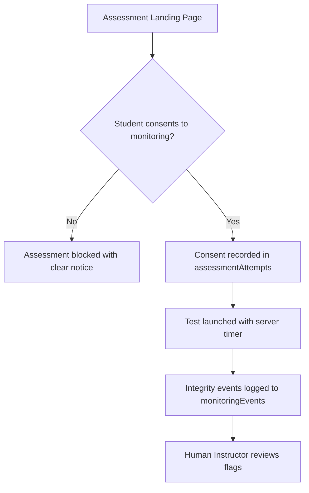

# EngineerOS — Privacy Policy & Student Data Protection

This document outlines the data governance principles, student consent lifecycle, assessment integrity disclosure, and data retention policies for **EngineerOS**.

---

## 1. Core Privacy Commitments

1. **Data Minimization**: We collect only the data necessary to provide personalized education, coding evaluation, mock interview coaching, and academic assessments.
2. **Transparent Monitoring**: No hidden or deceptive surveillance. All assessment monitoring requires explicit opt-in consent.
3. **No Automated Disqualification**: Monitoring events are treated solely as **"Review Signals"** for human faculty/proctors.
4. **Student Data Rights**: Full support for GDPR/DPDP-compliant data export (`GET /api/v1/users/me/export`) and right-to-be-forgotten account erasure (`DELETE /api/v1/users/me`).

---

## 2. Assessment Integrity & Monitoring Consent

Before starting any monitored assessment, students are presented with a non-dismissible Consent Modal detailing:

- **What is collected**: Browser visibility changes (tab hidden), window blur, fullscreen exits, and clipboard paste attempts.
- **Why it is collected**: To provide verification signals to course instructors for academic credit fairness.
- **Who sees it**: Course instructors and authorized platform administrators.
- **Camera/Audio**: **Disabled by default**. If a specific institutional assessment requires webcam verification, it is explicitly disclosed, optional where possible, and requires a separate camera permission prompt.

---

## 3. Data Retention & Automatic Purge Schedule

To avoid unbounded data hoarding, automated TTL indexes and retention policies are enforced:

| Data Type                         | Collection                   | Retention Period      | Purge Mechanism                               |
| --------------------------------- | ---------------------------- | --------------------- | --------------------------------------------- |
| Monitoring Events                 | `monitoringEvents`           | 60 days               | MongoDB TTL Index on `occurredAt`             |
| Raw Activity Stream               | `activityEvents`             | 90 days               | MongoDB TTL Index on `occurredAt`             |
| AI Chat History                   | `aiConversations`            | 180 days              | Configurable purge job                        |
| Refresh Tokens                    | `refreshTokens`              | 7 days (or on logout) | TTL Index on `expiresAt`                      |
| Core Academics & Code Submissions | `codingSubmissions`, `users` | Account Lifetime      | Retained until user requests account deletion |

---

## 4. Student Data Export and Erasure

- **Data Portability**: `GET /api/v1/users/me/export` compiles a downloadable JSON archive containing user profile, academic progress, solved coding problems, submission history, and mock interview reports.
- **Account Deletion**: `DELETE /api/v1/users/me` permanently wipes personal profile information, invalidates authentication sessions, and anonymizes community contributions in accordance with data privacy legislation.
