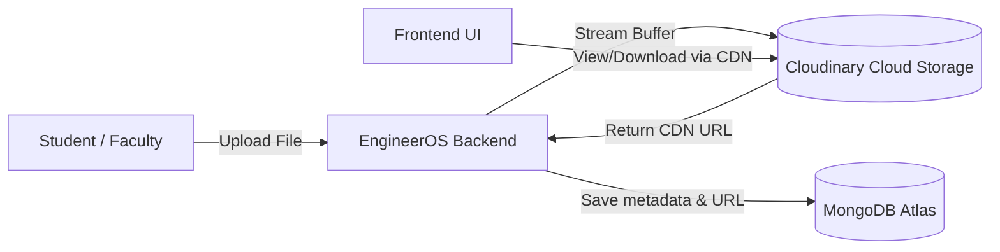
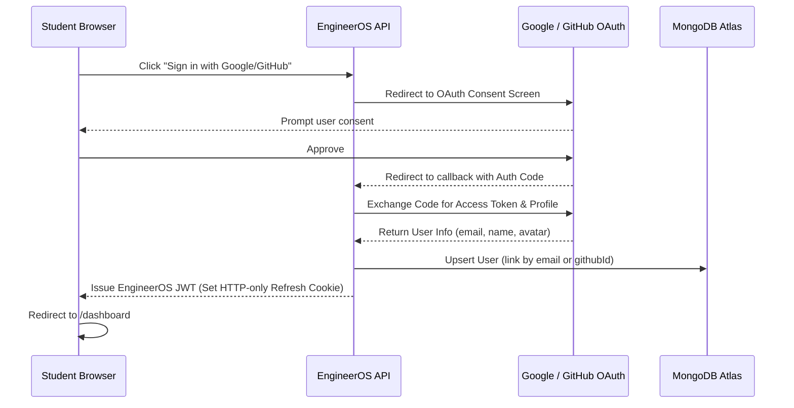
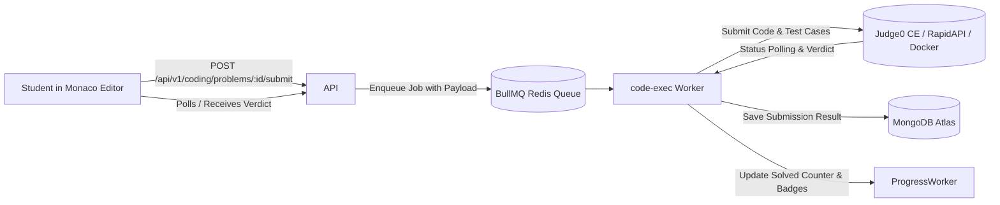

# EngineerOS — Future Integrations & External Services Roadmap

> **Status:** Pending / Scheduled  
> **Target:** Post-MVP Production Integrations  
> **Document Purpose:** Complete specification and setup guide for integrating external cloud providers, OAuth authentication, code sandboxes, and AI services.

---

## 1. Cloudinary (Cloud Storage for Notes, PYQs & Avatars)

### 1.1 Purpose & Use Cases
- **Academic Hub (Large Files):** Store lecture notes, handwritten summaries, past-year question papers (PYQs), lab manuals, and syllabus documents (PDF, DOCX, PPT) on a high-speed CDN without overloading MongoDB Atlas or local disk.
- **Profile Avatars:** Store student profile pictures with automated face-detection cropping, thumbnail generation, and modern WebP compression.
- **PDF Page Previews:** Generate instant PNG image previews of the first page of any uploaded PDF for curriculum subject cards.

### 1.2 Architecture

- Implements the existing [`IStorageAdapter`](file:///server/src/integrations/storage/storage.interface.js) contract as `CloudinaryStorageAdapter`.
- Saves the resulting `https://res.cloudinary.com/...` link into MongoDB Atlas (`AcademicResource.contentUrl` and `User.avatarKey`).

### 1.3 Required Environment Variables (`server/.env`)
```env
STORAGE_PROVIDER=cloudinary
CLOUDINARY_CLOUD_NAME=your_cloud_name
CLOUDINARY_API_KEY=your_api_key
CLOUDINARY_API_SECRET=your_api_secret
```

### 1.4 Implementation Steps When Ready
1. Install official SDK: `npm install cloudinary --workspace=server`
2. Create `server/src/integrations/storage/cloudinary.storage.js` implementing `IStorageAdapter`.
3. Add a file upload route in `server/src/modules/academics/academics.routes.js` using `multer`.
4. Add "Upload Resource" modal in [`AcademicsPage.jsx`](file:///client/src/features/academics/AcademicsPage.jsx).

---

## 2. Social OAuth Authentication (Google & GitHub Login)

### 2.1 Purpose & Use Cases
- **One-Click Sign In:** Allow students to sign in instantly using their college Google account or personal Gmail without remembering passwords.
- **Developer Identity (GitHub):** Allow engineers to sign in with GitHub, automatically pulling their public repositories, bio, and GitHub handle into their EngineerOS Profile Card.
- **Zero Friction:** Eliminate email verification steps for trusted OAuth accounts.

### 2.2 Architecture


### 2.3 Required Environment Variables (`server/.env`)
```env
# Google OAuth
GOOGLE_CLIENT_ID=your_google_client_id.apps.googleusercontent.com
GOOGLE_CLIENT_SECRET=your_google_client_secret
GOOGLE_CALLBACK_URL=http://localhost:5000/api/v1/auth/google/callback

# GitHub OAuth
GITHUB_CLIENT_ID=your_github_client_id
GITHUB_CLIENT_SECRET=your_github_client_secret
GITHUB_CALLBACK_URL=http://localhost:5000/api/v1/auth/github/callback
```

### 2.4 Implementation Steps When Ready
1. Install authentication middleware: `npm install passport passport-google-oauth20 passport-github2 --workspace=server`
2. Create `server/src/modules/auth/oauth.service.js` with Google and GitHub strategies.
3. Mount endpoints in `auth.routes.js`:
   - `GET /api/v1/auth/google` & `GET /api/v1/auth/google/callback`
   - `GET /api/v1/auth/github` & `GET /api/v1/auth/github/callback`
4. Add "Continue with Google" and "Continue with GitHub" buttons to [`LoginPage.jsx`](file:///client/src/features/auth/LoginPage.jsx) and [`RegisterPage.jsx`](file:///client/src/features/auth/RegisterPage.jsx).

---

## 3. Judge0 Real Code Execution Sandbox (DSA Coding Platform)

### 3.1 Purpose & Use Cases
- **Production Code Evaluation:** Replace the offline local mock runner with a sandboxed, isolated remote execution engine.
- **Multi-Language Support:** Compile and run solutions in **Python 3**, **C++ (GCC)**, **Java (OpenJDK)**, **JavaScript (Node)**, and **Go**.
- **Accurate Resource Caps:** Enforce strict execution time limits (e.g., 2000ms) and memory limits (e.g., 256MB) with exact verdicts:
  - `Accepted (AC)`
  - `Wrong Answer (WA)`
  - `Time Limit Exceeded (TLE)`
  - `Memory Limit Exceeded (MLE)`
  - `Compilation Error (CE)`
  - `Runtime Error (SIGSEGV/NZEC)`

### 3.2 Architecture


### 3.3 Required Environment Variables (`server/.env`)
```env
# Options: 'mock' (offline local runner) or 'judge0' (live API)
CODE_EXEC_PROVIDER=judge0
JUDGE0_API_URL=https://judge0-ce.p.rapidapi.com
JUDGE0_API_KEY=your_rapidapi_judge0_key
```
*(Alternatively, self-host via `docker-compose -f judge0-stub/docker-compose.yml up -d`)*

### 3.4 Implementation Steps When Ready
1. Obtain an API key from RapidAPI Judge0 CE (has a generous free tier of 50 submissions/day) or start the self-hosted container.
2. Toggle `CODE_EXEC_PROVIDER=judge0` in `server/.env`.
3. Verify `server/src/integrations/judge0/judge0.adapter.js` handles token polling and error diagnostics.

---

## 4. Production AI LLM Provider (Anthropic Claude / OpenAI / Gemini)

### 4.1 Purpose & Use Cases
- **Academic Assistant:** Real-time Server-Sent Events (SSE) streaming answers to syllabus doubts, grounded in lecture notes with mathematical formula rendering (KaTeX) and syntax-highlighted code.
- **AI Mock Interviews:** Conduct multi-turn interactive voice/text technical and HR interviews with comprehensive rubric evaluations across:
  - Technical Accuracy (1–10)
  - Algorithmic Complexity Explanation (1–10)
  - Communication Clarity (1–10)
  - Confidence & Culture Fit (1–10)

### 4.2 Required Environment Variables (`server/.env`)
```env
# Anthropic Claude Integration
LLM_PROVIDER=anthropic
ANTHROPIC_API_KEY=sk-ant-api03-...
LLM_MODEL=claude-3-5-sonnet-20241022

# Or Google Gemini Integration (Optional Alternative)
# LLM_PROVIDER=gemini
# GEMINI_API_KEY=AIzaSy...
# LLM_MODEL=gemini-1.5-pro
```

### 4.3 Implementation Steps When Ready
1. Set `LLM_PROVIDER=anthropic` and paste `ANTHROPIC_API_KEY` in `server/.env`.
2. The existing `server/src/integrations/llm/anthropic.adapter.js` will automatically activate for all assistant chats and interview grading.

---

## 5. Real Transactional Email Service (Resend / AWS SES / Nodemailer)

### 5.1 Purpose & Use Cases
- **Account Security:** Deliver email verification tokens upon registration and password reset OTP links.
- **Interview Reports:** Send candidate performance reports and score cards to students' inboxes.
- **Milestones & Alerts:** Notify students of active streak milestones or new responses to their "Ask a Senior" posts.

### 5.2 Recommended Provider
- **Resend ([resend.com](https://resend.com)):** Free tier includes 3,000 emails/month (100 emails/day), zero configuration, and clean modern REST API.

### 5.3 Required Environment Variables (`server/.env`)
```env
EMAIL_PROVIDER=resend
RESEND_API_KEY=re_123456789...
EMAIL_FROM=EngineerOS <onboarding@resend.dev>
```

---

## 6. Phase 6 Admin Console & Faculty Portal

### 6.1 Purpose & Use Cases
- **Problem Authoring Studio:** Web interface for teachers and admins to create algorithm problems with starter templates and hidden test cases.
- **Assessment Scheduler:** Create proctored midterm/quiz exams with automated anti-cheat tracking rules.
- **Review Signals Console:** Moderation dashboard to inspect student telemetry flags (`tab_hidden`, `window_blur`) and approve/dismiss violations.
- **User Role Management:** Promote top students to verified `senior` mentors or `contentAdmin`.

---

## 7. Quick Priority Matrix for Rollout

| Priority | Integration | Complexity | Cost | Impact |
| :---: | :--- | :---: | :---: | :--- |
| **P1** | **Cloudinary** (Notes & Avatars) | Low | Free (25 GB) | ⭐⭐⭐⭐⭐ *Immediate file persistence* |
| **P1** | **Google & GitHub Login** | Medium | Free | ⭐⭐⭐⭐⭐ *Frictionless user onboarding* |
| **P2** | **Judge0 Live API** | Low | Free tier | ⭐⭐⭐⭐ *Real test case validation* |
| **P2** | **Anthropic Claude / Gemini** | Low | Pay-per-token | ⭐⭐⭐⭐⭐ *Supercharges AI Assistant* |
| **P3** | **Resend Transactional Email** | Low | Free (3000/mo) | ⭐⭐⭐ *Production notification loop* |
| **P3** | **Phase 6 Admin Console** | Medium | Free (Internal) | ⭐⭐⭐⭐ *Faculty test management* |

---

*This document is kept under version control in `docs/ROADMAP_INTEGRATIONS.md` to guide future development passes.*

