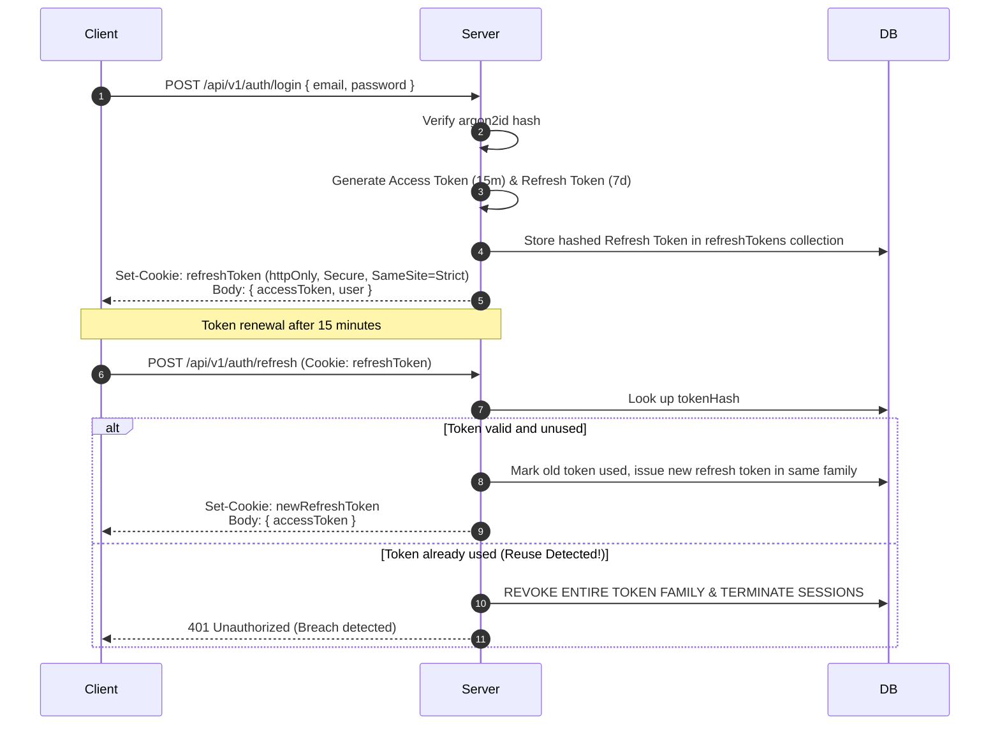

# EngineerOS — Security Architecture & Threat Model

This document outlines the security controls, authentication mechanisms, data sanitization rules, and threat mitigation strategies implemented across **EngineerOS**.

---

## 1. Threat Model & Mitigation Matrix

| Threat Category                       | Potential Attack Vector                                                       | EngineerOS Mitigation                                                                                                                                                                              |
| ------------------------------------- | ----------------------------------------------------------------------------- | -------------------------------------------------------------------------------------------------------------------------------------------------------------------------------------------------- |
| **Remote Code Execution (RCE)**       | Malicious code in coding submissions attempting host exploitation.            | **Zero Host Execution**: All untrusted student code is isolated in a sandboxed container (Judge0) with seccomp filters, no internet access, and strict cgroup CPU/memory caps (256MB, 3s timeout). |
| **Token Theft / Replay (XSS / CSRF)** | Storing JWTs in `localStorage` allows theft via injected scripts.             | Access token kept in volatile frontend memory. Rotating refresh token stored in `httpOnly`, `Secure`, `SameSite=Strict` cookie. Detects and instantly revokes compromised token families.          |
| **Credential Stuffing / Brute Force** | Automated dictionary attacks against `/api/v1/auth/login`.                    | Multi-tier rate limiting (10 req/min on auth routes), argon2id password hashing, and progressive account lockout after 5 consecutive failed attempts.                                              |
| **NoSQL Injection**                   | Malicious JSON payloads with MongoDB operators (e.g. `{"$gt": ""}`).          | Request bodies, query parameters, and URL parameters strictly validated and stripped via Zod schemas prior to reaching database queries.                                                           |
| **Cross-Site Scripting (XSS)**        | Malicious JavaScript inside user-submitted markdown (community posts, notes). | User markdown is parsed and sanitized through DOMPurify before HTML rendering. Content Security Policy (CSP) headers disallow inline scripts.                                                      |
| **Resource Starvation / DoS**         | Flood of requests or massive payloads exhausting server memory.               | Body parsers enforce strict 10MB payload caps; Redis-backed tiered rate limiters; cursor pagination caps max page size to 50 items.                                                                |
| **Privilege Escalation**              | Manipulating user payloads or endpoints to gain `platformAdmin` rights.       | RBAC middleware checks authenticated roles and explicit permission claims on every protected endpoint server-side.                                                                                 |

---

## 2. Authentication & Session Security

### 2.1 Password Storage

- Passwords are encrypted using **Argon2id** (configured with memory cost: 64MB, time cost: 3 iterations, parallelism: 1) or **Bcrypt** with cost >= 12.
- Plaintext passwords are never logged, persisted, or returned in any API response.

### 2.2 JWT & Token Rotation

---

## 3. HTTP Security Headers

The Express application configures Helmet with strict headers:

- `Content-Security-Policy`: Default `'self'`, scripts restricted, object-src `'none'`.
- `X-Content-Type-Options`: `nosniff`.
- `X-Frame-Options`: `DENY` (prevents clickjacking).
- `Strict-Transport-Security`: `max-age=31536000; includeSubDomains; preload`.
- `Referrer-Policy`: `strict-origin-when-cross-origin`.

---

## 4. Audit Logging

Every administrative state change (user role modification, content publishing, problem modification, assessment flag review) is persisted to an append-only `auditLogs` collection with:

- `actorId` & `actorRole`
- `action` (e.g. `USER_ROLE_UPDATED`, `ASSESSMENT_FLAG_DISMISSED`)
- `targetDomain` & `targetId`
- `ipAddress` & `userAgent`
- `occurredAt` timestamp
